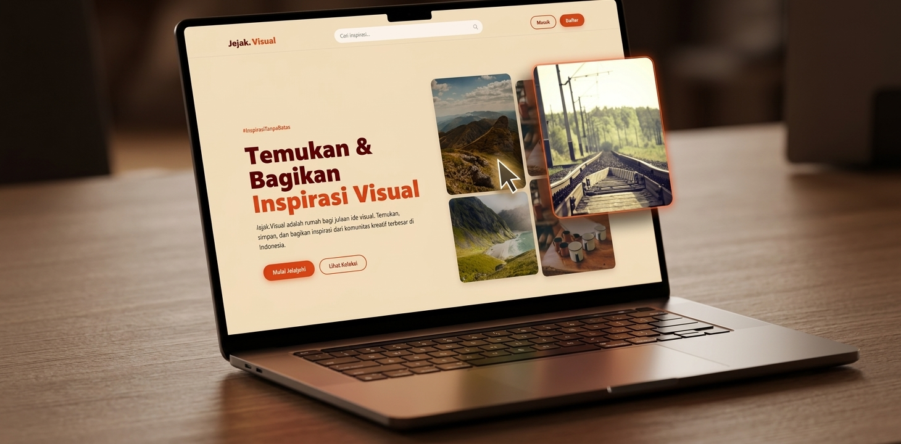
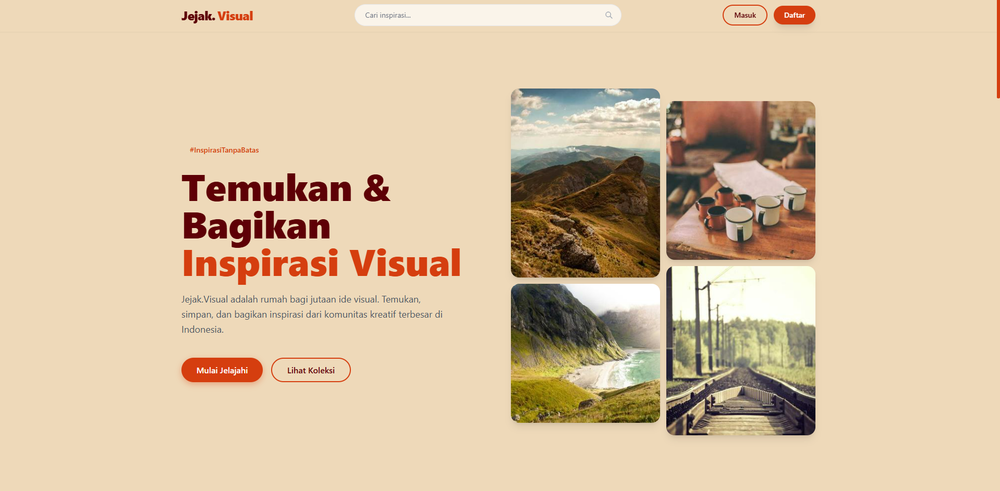
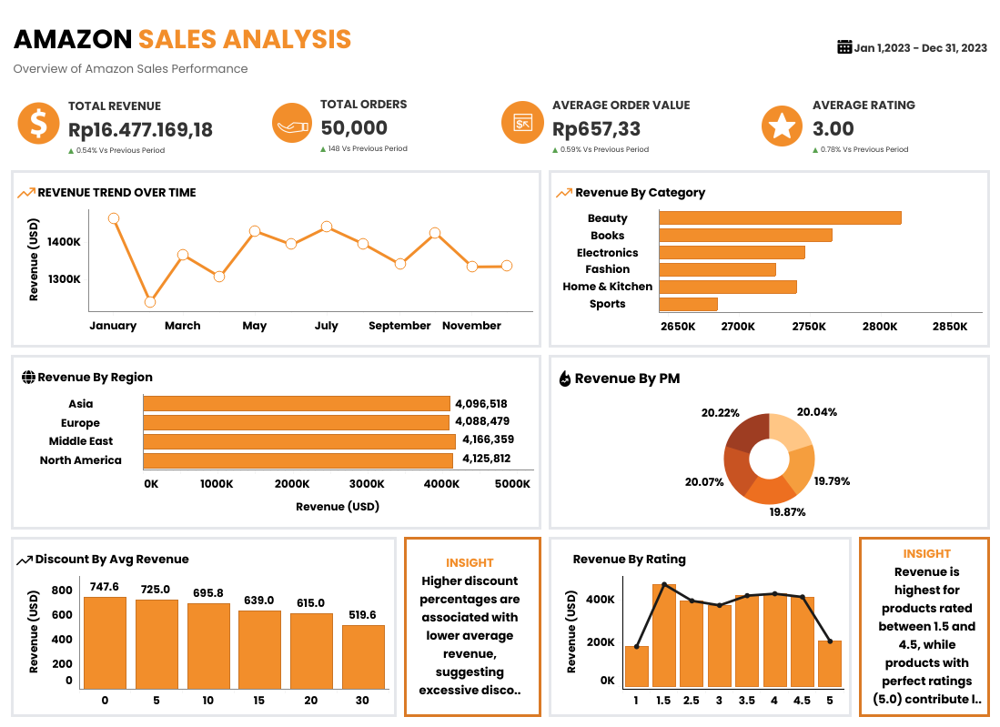

```markdown
<div align="center">

# 🎨 Raffa's Playground

### A Playful, Scroll-Driven Personal Identity Website

> **"Student by title, builder by habit."**

[](https://react.dev)
[](https://vitejs.dev)
[](https://tailwindcss.com)
[](https://gsap.com)
[](https://www.framer.com/motion/)

[](https://mraffaizzelh.vercel.app)
[](https://opensource.org/licenses/MIT)

**[Live Demo](https://mraffaizzelh.vercel.app) • [Case Study](https://mraffaizzelh.vercel.app/work/jejak-visual) • [Contact](mailto:1mraffaizzelh@gmail.com)**

</div>

---

## 🌟 About The Project

**Raffa's Playground** is not just a portfolio. It's a short film you scroll through. Designed to bridge the gap between "here is my work" and "here is who I am."

Built with a **Burgundy & Cream** aesthetic, this website is a playground for playful interactions, but serious about the content. It features horizontal scroll storytelling, physics-based sticker piles, intricate SVG line animations, and a custom-built certificate gallery.

### ✨ Why "Playground"?
Because learning should be fun. This site is a space to experiment with web technologies, animations, and design principles—all while telling the story of a student, builder, and data enthusiast.

---

## 📸 Preview

<div align="center">

### 🎯 Hero Section


### 🖥️ Project Showcase



</div>

---

## 🚀 Key Features

<table>
  <tr>
    <td width="50%">
      <h3>🎬 Cinematic Transitions</h3>
      <p>Page transitions using <b>Framer Motion</b> that feel like a movie—from the "Curtain Reveal" blocks to the "Line-to-Circle" expand effect.</p>
    </td>
    <td width="50%">
      <h3>📜 Scroll as a Story</h3>
      <p>Using <b>GSAP ScrollTrigger</b>, the website behaves like an 8-scene film, featuring horizontal project scrolling, pinned timelines, and parallax effects.</p>
    </td>
  </tr>
  <tr>
    <td width="50%">
      <h3>🧲 Micro-Interactions</h3>
      <p>Custom cursor, magnetic buttons, instant hover states, and <b>Physics-based Sticker Pile</b> using Matter.js. Every click makes a sound.</p>
    </td>
    <td width="50%">
      <h3>🗂️ Interactive Certificates</h3>
      <p>A curated "Wall of Fame" where certificates are showcased in an asymmetric layout, complete with a portal-style modal view.</p>
    </td>
  </tr>
</table>

---

## 🛠️ Tech Stack

This project is built with modern web technologies to ensure high performance, scalability, and a smooth user experience.

- **Core:** [React 19](https://react.dev/) + [Vite 8](https://vitejs.dev/)
- **Styling:** [Tailwind CSS v4](https://tailwindcss.com/) + Custom CSS Variables
- **Animation:**
  - [GSAP](https://gsap.com/) & ScrollTrigger (Complex scroll animations)
  - [Framer Motion](https://www.framer.com/motion/) (Page transitions & UI reveals)
  - [Lenis](https://lenis.darkroom.engineering/) (Smooth inertia scrolling)
- **Interactions:**
  - [Matter.js](https://brm.io/matter-js/) (2D Physics engine for stickers)
- **Typography:**
  - Bricolage Grotesque (Display)
  - Instrument Serif (Accent)
  - Inter (Body)
  - Space Mono (Labels)
- **Data:** Local JSON files (Easy content management without a backend)
- **Deployment:** [Vercel](https://vercel.com/)

---

## ⚡ Performance & Accessibility

- **60 FPS Animations:** Using `transform` and `opacity` combined with `will-change` and GPU acceleration.
- **Responsive:** Redesigned layouts for mobile (e.g., horizontal scroll is disabled on mobile, replaced with vertical cards).
- **Accessibility:** Respects `prefers-reduced-motion`, keyboard navigation support, and semantic HTML.
- **Lazy Loading:** Images and videos are loaded asynchronously to ensure fast initial load times.

---

## 💻 How to Run Locally

Want to explore the code? Follow these steps:

### Prerequisites
- Node.js (v18 or higher)
- npm or pnpm or yarn

### Installation

1. **Clone the repository**
   ```bash
   git clone https://github.com/RaffaHmii/raffa-playground.git
   cd raffa-playground
   ```

2. **Install dependencies**
   ```bash
   npm install
   ```

3. **Run the development server**
   ```bash
   npm run dev
   ```
   The app will be available at `http://localhost:5173`.

4. **Build for production**
   ```bash
   npm run build
   ```

---

## 📂 Project Structure

```text
raffa-playground/
├── public/
│   ├── brand/          # Logos & monogram
│   ├── img/            # Project screenshots & avatars
│   ├── photos/         # Gallery photos (Beyond section)
│   ├── sound/          # UI click sounds (blob.mp3)
│   └── textures/       # Grain & contour patterns
├── src/
│   ├── assets/         # Global assets
│   ├── components/
│   │   ├── global/     # Navbar, Cursor, Loader, Grain
│   │   ├── scenes/     # Hero, WhatIDo, Projects, Story, Beyond, Skills, Contact
│   │   └── ui/         # Reusable UI (Magnetic, Chars, Marquee, StickerPile)
│   ├── config/         # Site configuration (site.js)
│   ├── data/           # Content data (projects.json, certificates.json, dll)
│   ├── hooks/          # Custom hooks (useSound, useLenis)
│   ├── pages/          # Home, CaseStudy, Certificates, NotFound
│   └── index.css       # Global styles & Tailwind theme
├── vercel.json         # Vercel routing configuration
└── vite.config.js      # Vite configuration
```

---

## 🤝 Let's Connect!

I'm always open to collaborating on interesting projects, discussing data, or just talking about tech and design. 

- **Website:** [mraffaizzelh.vercel.app](https://mraffaizzelh.vercel.app)
- **LinkedIn:** [M. Raffa Izzel Hendro](https://www.linkedin.com/in/raffa-izzel/)
- **GitHub:** [@RaffaHmii](https://github.com/RaffaHmii)
- **Email:** [1mraffaizzelh@gmail.com](mailto:1mraffaizzelh@gmail.com)

---

<div align="center">

**Designed & Built by Raffa. Powered by Coffee.** ☕

*If you like this project, feel free to give it a ⭐!*

</div>
```
